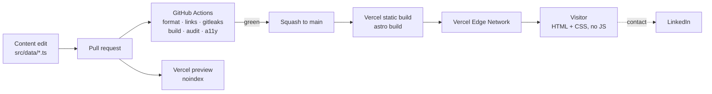

# Architecture

A one-page static site. The interesting decisions are about what is _absent_, and those are recorded
in [decisions/](./decisions/README.md).

## System shape

There is no server, no database, no session, no API, and no secret. A request for any page is a
static file served from a CDN. The contact path leaves the system entirely
([ADR-0003](./decisions/0003-defer-contact-form.md)), which is why the diagram has no inbound arrow
other than the visitor's.

## Layers

| Layer     | Choice                                  | Rationale                                                                                                                |
| --------- | --------------------------------------- | ------------------------------------------------------------------------------------------------------------------------ |
| Content   | Typed TypeScript modules in `src/data/` | The edit surface for every content change. Typed so a malformed project card fails the build instead of rendering wrong. |
| Templates | Astro components, static output         | Zero runtime JavaScript by default. See [ADR-0001](./decisions/0001-astro-static-first.md).                              |
| Styles    | Plain CSS, custom-property tokens       | A one-page site does not amortize a framework's bytes or its learning cost.                                              |
| Build     | `astro build` → `dist/`                 | Fully static. No SSR adapter.                                                                                            |
| Hosting   | Vercel, Git integration                 | See [ADR-0002](./decisions/0002-vercel-static-hosting.md).                                                               |
| Contact   | LinkedIn                                | See [ADR-0003](./decisions/0003-defer-contact-form.md).                                                                  |

## Performance budget

Enforced in CI by `pnpm audit:dist` (arrives with M1-5), not by review.

| Budget                                  | Limit                                   |
| --------------------------------------- | --------------------------------------- |
| Client JavaScript on `/`                | **0 bytes**                             |
| HTML + CSS + fonts on `/`, uncompressed | **≤ 60 KB**                             |
| Webfonts                                | **0** — system font stack only          |
| Third-party origins                     | **0**                                   |
| Images                                  | Intrinsic `width`/`height` on every one |

The budget is deliberately structural. Measuring Lighthouse Performance on a zero-JavaScript static
page reports the CI runner's mood, not the site's quality; asserting that no JavaScript shipped and
that the page is under 60 KB catches the regressions this site can actually suffer. There is no
field Core Web Vitals data, and there will not be, because third-party analytics is a non-goal —
that trade-off is accepted, not overlooked.

## Why a React island is not here yet

React is not a dependency of this project. It is added only alongside the first island that
justifies it, and that justification has to name three things in the PR: the concrete interactive
behavior, the hydration cost measured against the byte budget above, and the no-JavaScript fallback.
Absent any of the three, the answer is no. Installing a framework to demonstrate familiarity with
it, on a page that needs no framework, demonstrates the opposite.

## Deployment and rollback

- `main` → Vercel production. Every PR → a Vercel preview carrying `X-Robots-Tag: noindex`.
- **Rollback is instant:** promote the previous deployment in the Vercel dashboard. There is no
  migration, no cache to warm, and no state to reconcile, which is a direct benefit of the static
  choice.
- Post-deploy verification is manual and short: every external link, the resume download, and the
  page at 320px. External links are not checked in CI because that would make the build depend on
  someone else's uptime.
