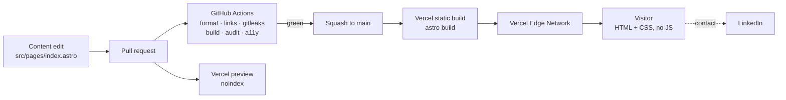

# Architecture

A one-page static site. The interesting decisions are about what is _absent_, and those are recorded
in [decisions/](./decisions/README.md).

## System shape

There is no server, no database, no session, no API, and no secret. A request for any page is a
static file served from a CDN. The contact path leaves the system entirely
([ADR-0003](./decisions/0003-defer-contact-form.md)), which is why the diagram has no inbound arrow
other than the visitor's.

## Layers

| Layer     | Choice                                 | Rationale                                                                                    |
| --------- | -------------------------------------- | -------------------------------------------------------------------------------------------- |
| Content   | Inline in each page under `src/pages/` | Two pages. A data layer between an author and two files would be indirection, not structure. |
| Templates | Astro components, static output        | Zero runtime JavaScript by default. See [ADR-0001](./decisions/0001-astro-static-first.md).  |
| Styles    | Plain CSS, custom-property tokens      | A one-page site does not amortize a framework's bytes or its learning cost.                  |
| Build     | `astro build` → `dist/`                | Fully static. No SSR adapter.                                                                |
| Hosting   | Vercel, Git integration                | See [ADR-0002](./decisions/0002-vercel-static-hosting.md).                                   |
| Contact   | LinkedIn                               | See [ADR-0003](./decisions/0003-defer-contact-form.md).                                      |

## Performance budget

Enforced in CI by `pnpm audit:dist`, not by review. Every assertion below has been seen to fail.

| Budget                                  | Limit                                   |
| --------------------------------------- | --------------------------------------- |
| Client JavaScript on `/`                | **0 bytes**                             |
| HTML + CSS + fonts on `/`, uncompressed | **≤ 60 KB**                             |
| Webfonts                                | **0** — system font stack only          |
| Third-party origins                     | **0**                                   |
| Images                                  | Intrinsic `width`/`height` on every one |

The budget is deliberately structural. Measuring Lighthouse Performance on a zero-JavaScript static
page reports the CI runner's mood, not the site's quality; asserting that no JavaScript shipped and
that the page is under 60 KB catches the regressions this site can actually suffer. There is no
field Core Web Vitals data, and there will not be, because third-party analytics is a non-goal —
that trade-off is accepted, not overlooked.

## Why the homepage has no sections

The homepage shows a name and three links. No tagline, bio, project cards, experience list, nav bar
or footer. That is a product decision, not an unfinished state: its job is to identify its owner and
point at where to go next, and anything added to make it look more substantial would work against
that. The biography lives at `/about`, where someone who wants it has asked for it.

Several things a portfolio usually needs are still absent on purpose: no `src/data/`, no component
directory, no routing library, and no page that exists to pad the site out.

### When the layout arrived

`src/layouts/BaseLayout.astro` holds the document head, the palette, the type scale and the content
column. This document previously argued **against** a layout, on the grounds that a wrapper around a
single page is a layer with nothing to share. That was right while there was one page, and it
stopped being right when `/about` arrived: the alternative is now two copies of the palette and the
base type, and two copies of a thing drift.

The reasoning is recorded rather than quietly reversed, because the rule it illustrates outlives the
decision: **an abstraction is introduced when a second caller makes it cheaper than the duplication,
not when it is first imagined.**

A **Contact** link is planned, and will sit after LinkedIn pointing at a `/contact` page. Nothing is
reserved for it in advance: no placeholder markup, no route, no styling hook. See
[ADR-0003](./decisions/0003-defer-contact-form.md) and M2 in [plan.md](./plan.md).

## Why a React island is not here yet

React is not a dependency of this project. It is added only alongside the first island that
justifies it, and that justification has to name three things in the PR: the concrete interactive
behavior, the hydration cost measured against the byte budget above, and the no-JavaScript fallback.
Absent any of the three, the answer is no. Installing a framework to demonstrate familiarity with
it, on a page that needs no framework, demonstrates the opposite.

## Deployment and rollback

- `main` → Vercel production. Every PR → a Vercel preview carrying `X-Robots-Tag: noindex`.
- **Rollback is instant:** promote the previous deployment in the Vercel dashboard. There is no
  migration, no cache to warm, and no state to reconcile, which is a direct benefit of the static
  choice.
- Post-deploy verification is manual and short: every external link, the resume download, and the
  page at 320px. External links are not checked in CI because that would make the build depend on
  someone else's uptime.
